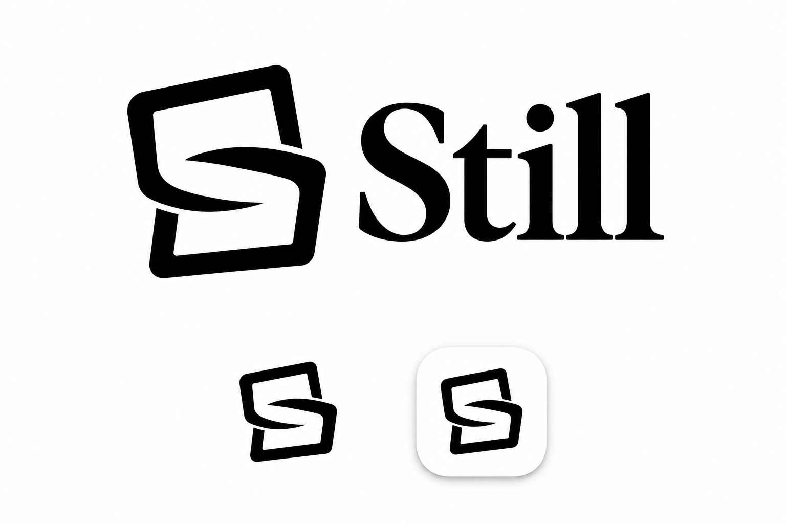

# Still



一款本地相册应用。Mac 版支持照片墙、旁注和双页阅读；iPhone 版支持叠放封面、照片浏览和旁注。

## iPhone 客户端

iOS 17+，原生 SwiftUI。封面参考 [Shopify Editions](https://www.shopify.com/editions) 窄屏下的纵向封套布局：上下滑动或点按箭头切换相册，点击封面或底部「打开」进入相册。

- 从系统照片选择器创建相册或追加照片，导入受管理的本地副本。
- 重命名相册、设置封面、移除照片、删除相册。
- 网格浏览、左右翻照片、编辑标题与旁注，退出后保留。
- 支持深色模式、减少动态效果；横屏与辅助功能大字体改为可滚动列表。

打开 `Still-iOS.xcodeproj`，选择 `StillIOS` scheme 和 iPhone 模拟器运行。命令行构建：

```sh
bash scripts/build-ios.sh
```

真机运行需在 Xcode 的 Signing & Capabilities 中选择自己的开发团队。当前未发布 TestFlight / App Store。照片和相册保存在本机，尚未实现与 Mac 的同步。

调试启动参数 `-still-demo` 加载独立示例库，不接触正常相册。示例图片来自仓库已有样片，来源见 `previews/photo-albums/photo-sources.json`。Release 构建不启用示例库入口。验收说明见 `docs/ios-validation/README.md`。

## 原生客户端

当前主实现位于 `Sources/ContactSheet`，使用 SwiftUI 和 SwiftData，需要 macOS 14+ 和 Xcode。

- 从本地文件或 Apple Photos 导入照片，保存受管理的照片副本。
- 多本相册、封面目录、四行流动照片墙。
- 照片标题和多段旁注编辑、双页阅读。
- 相册关系与描述保存在本机；开发版和正式版使用独立资料库。

```sh
# 单元测试
scripts/test.sh

# Debug 构建
scripts/build.sh

# 独立资料库的相册开发版
scripts/build-albums-dev.sh

# Release 构建
DEVELOPER_DIR=/Applications/Xcode.app/Contents/Developer \
  xcodebuild -project ContactSheet.xcodeproj -target ContactSheet \
  -configuration Release SYMROOT="$PWD/build" build
```

Release 产物为 `build/Release/Still.app`。这些是本地构建，尚未作为公证安装包发布。构建产物与用户相册数据库不纳入版本管理。

## 目录

- `Sources/`、`Tests/`：原生应用与测试。
- `Sources/StillIOS/`：iPhone 界面；与 Mac 共用 `Models.swift`、`PhotoRepository.swift`。
- `scripts/`：项目生成、构建和测试脚本。
- `docs/album-flow-validation/`：验收记录与截图，包含截图工具的已知限制。
- `previews/photo-albums/`：早期 HTML 相册原型、样片及其来源记录。
- `prototype/`：独立 NSH / Rust 跨平台技术原型，尚非当前正式客户端。

当前范围不包含桌面小组件。Apple Photos 导入及 Windows 原型仍需进一步实机验收；本地文件导入、旁注保存和重启恢复已验证。摄影样片的来源见 `previews/photo-albums/photo-sources.json`。

应用显示名称为 Still；为兼容已保存的相册，bundle ID 和内部工程目标仍沿用原标识。图标源文件与打包说明见 `docs/branding/README.md`。
