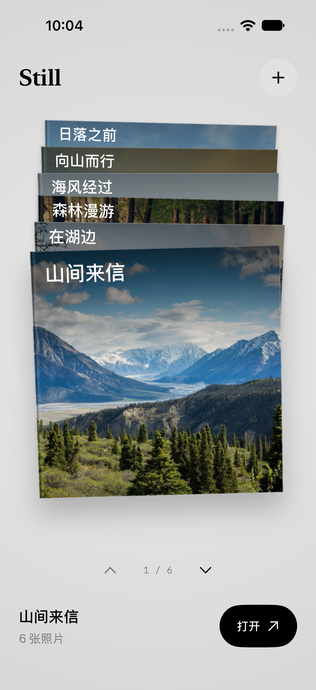
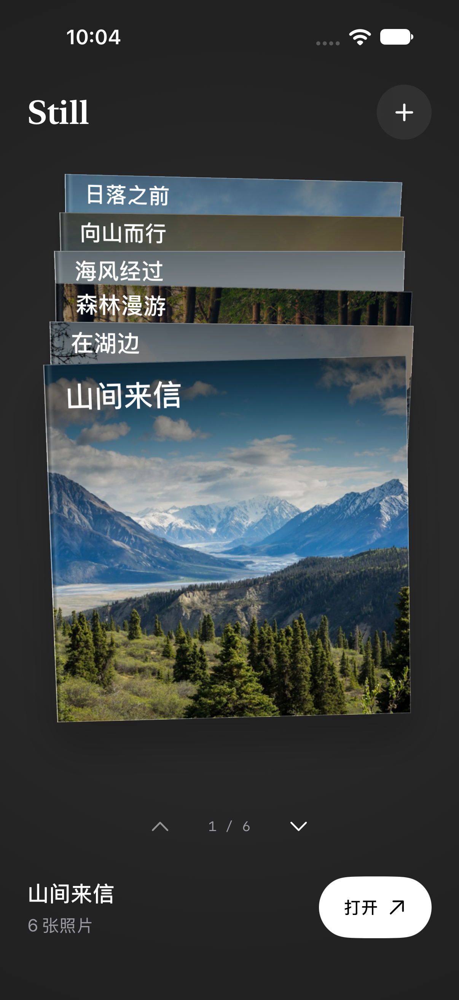

# iPhone 首版 · 2026-11-15

原生 iPhone 客户端位于 `Sources/StillIOS`，工程为 `Still-iOS.xcodeproj`，scheme 为 `StillIOS`，最低部署版本 iOS 17。

## 封面与交互

参考 [Shopify Editions](https://www.shopify.com/editions) 的 390 × 844 窄屏布局：纵向叠放封套、当前封面置前、底部显示当前项并提供打开操作。使用项目自己的照片和名称，不使用 Shopify 的品牌素材。

- 向上滑动查看下一本，向下返回；也可以点箭头或后排封面。点击当前封面或「打开」进入相册。
- 一次绘制最多六张封面，其余相册可继续切换。首尾按钮禁用，不丢失相册。
- 后排封面的标题缩小并贴近上沿，避免遮挡。系统开启减少动态效果时关闭透视、拖动偏移和切换弹簧动画。
- 深色模式调整背景与按钮对比度；辅助功能大字体与横屏使用可滚动相册列表。

## 数据与功能

与 Mac 共用 `ContactAlbum`、`AlbumPhoto`、`PhotoAnnotation`、`LibraryStore` 和照片导入代码。照片仓库通过平台图像类型分别返回 `NSImage` / `UIImage`。

系统 PhotosPicker 只交付用户选择的照片，导入后保留受管理副本；相册、封面与旁注保存在应用沙盒。支持新建、追加照片、重命名、删除相册、移除照片、设为封面、照片翻页和旁注编辑。目前没有 Mac 同步、iCloud 同步或独立 iPad 界面。

正常资料库、`-still-demo` 示例库、每次 UI 测试的 UUID 资料库相互独立。`-still-demo` 和 `-still-dark` 只在 Debug 构建生效；正常启动跟随系统外观，初始为空相册。

## 验证

- Xcode 27.2，iPhone 18 Pro / iOS 27.0 模拟器，402 × 874 点。
- iOS Simulator Debug 编译通过；iPhone Release 无签名编译通过。
- Mac 原有 6 项测试通过，覆盖持久化、受管理导入、去重、损坏文件、相册关系和播放逻辑。
- UI 已验证空库、取消导入、滑动切换、末本边界、进入相册、打开照片、保存旁注、重启后恢复、大字体列表；深色截图通过 Debug 外观参数生成并人工检查。
- 初期封面按钮抢占拖动手势，已用高优先级拖动解决并通过实际滑动测试。
- 系统照片选择器导入、创建相册、重启恢复及打开导入照片通过。当前 iOS 27 选择器的照片是可访问图像节点，确认按钮名为「完成」；测试已根据实际控件修正。
- 5 项 UI 用例全部通过：4 项结果保存在 `build/ios-verified.xcresult`，修正定位后的导入用例保存在 `build/ios-import-verified.xcresult`。前一个结果包仍保留修正前的导入测试失败记录。

尚未在真实 iPhone、iOS 17 运行时、VoiceOver 或 iCloud 原图下载场景验收；重命名、删除和封面更换尚未单独做 UI 自动化。横屏测试确认切换后入口仍可操作，但截图工具在旋转时出现裁切，不以该截图作为完整视觉验收证据。未签名安装到真机，未发布 TestFlight / App Store。

## 截图

以下是 XCTest 从实际运行应用取得的截图，使用独立示例库。

| 封面 | 深色 |
| --- | --- |
|  |  |

[相册照片](iphone-album.png) · [保存的旁注](iphone-annotation.png) · [辅助功能大字体](iphone-large-text.png) · [实际导入的单张相册](iphone-imported.png)

## 复现

```sh
bash scripts/build-ios.sh

# 查看可用模拟器，填写自己的 UUID。
export DEVELOPER_DIR=/Applications/Xcode.app/Contents/Developer
xcrun simctl list devices available
IOS_SIMULATOR_ID=<iPhone模拟器UUID> bash scripts/test-ios.sh
```

测试脚本会启动所选模拟器并往系统照片库添加仓库样片，然后运行 UI 用例；测试数据写入独立的 `Still-Tests/<UUID>` 目录。

在 Xcode 中选择 `StillIOS` scheme 和 iPhone 运行。若要查看六本示例相册，在 Run → Arguments 中添加 `-still-demo`。真机运行需在 Signing & Capabilities 中选择开发团队。
